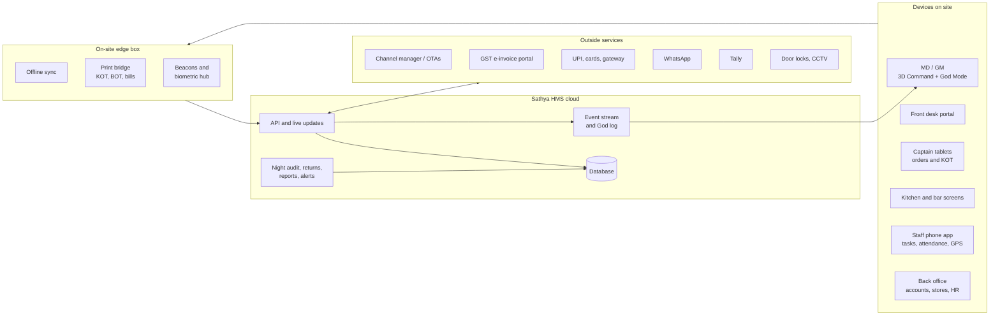
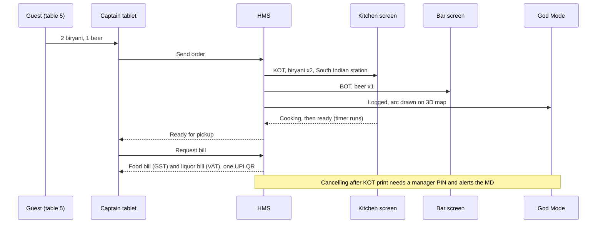

# Sathya HMS Blueprint

_Sathya Park & Resorts · Product plan · October 2026 · [Formatted version](hms-blueprint.html)_

The complete hotel management system behind the Sathya Command 3D dashboard. It runs every department of the resort, has its own login for every role, builds in GST, TDS and Tamil Nadu VAT, and gives the owner a God Mode that sees and records every action as it happens.

**17** modules

**19** login roles

**11** phases (1 already done)

**~12 mo** to full system, first go-live in month 5

**About the tax content.** Rates and rules here reflect the law as of October 2026 as far as I know it. In the software, every rate sits in a dated tax table that the accounts team can change without new code. Your chartered accountant signs off the full tax set-up in Phase 0. Items marked CA check need that confirmation before go-live.

## 01 · Principles

Seven rules that every screen and every feature must follow.

**One system, one record** Rooms, restaurant, bar, stores, accounts and HR share one database. Nothing is typed twice. A room-service order lands on the guest's bill, reduces kitchen stock and appears in the accounts without anyone re-entering it.

**The 3D resort is the front door** Every module appears on the map, and every building, room, lawn, store and machine on the map opens its module.

**Every action is an event** Each action records who did it, what changed (before and after), where, when and on which device. The same stream feeds God Mode, the audit log and the live 3D view.

**Compliance as a by-product** GST invoices, TDS, VAT registers, excise stock books, Form C and FSSAI records come out of normal daily work instead of month-end paperwork.

**Nimble** Screens open in under 2 seconds and point-of-sale taps respond in under 0.15 seconds. Kitchen tickets, billing and housekeeping keep working through internet cuts.

**Easy for every employee** Tamil and English throughout, large touch targets, common jobs in three taps, and it runs on low-cost Android phones.

**Owner stays in control** Approval limits by role, no silent deletions, and corrections made only by visible reversal entries. Owner-level actions need two-factor sign-in.

## 02 · System map

Each person uses one app made for their job, and all of them talk to the same core. A small on-site box keeps printing and billing working if the internet goes down.

## 03 · Logins & roles

Each person signs in with their own login and sees only what their job needs. These are starting templates. The MD can create new roles by ticking permissions, give one person several roles, and change any approval limit. The limits shown are examples to agree in Phase 0.

| Role | Sees | Can do | Approval limits (example) | Device |
| --- | --- | --- | --- | --- |
| Managing Director God Mode | Everything, live: every department, every rupee, every staff position, the full audit log and replay | Approve anything, lock or log out any user, change roles and limits, publish 3D layout changes, view rates and revenue | Unlimited | Any; two-factor or biometric required |
| General Manager | All operations, financial summaries, staff map | Approve discounts, complimentary stays, refunds, rate overrides, purchases above store limits | Discount up to 25%, refunds up to ₹50,000 | Laptop, tablet, phone |
| Operations Manager | Front office, housekeeping, F&B, engineering, security, staff map | Assign staff, approve voids, room moves, out-of-order, overtime | Voids up to ₹5,000 per bill | Tablet, phone |
| Front Office Manager | Reservations, room rack on 3D, guest profiles, folios, city ledger | Everything reception does, plus rate changes, refunds and cashier variances within limit | Discount up to 15% | Desk PC, tablet |
| Reception (front desk) | Arrivals, departures, room status, guest folios | Book, check in and out, take payments, issue keys, room moves, Form C | Discount up to 10% | Desk PC with ID scanner |
| Night Auditor | Day's transactions, cashier shifts, exceptions | Run night audit and day close, post room charges, print report pack | None | Desk PC |
| Accounts (back office) | Invoices, payables, receivables, banks, GST, TDS, VAT, payroll postings | Post vouchers, reconcile, prepare return data, pay vendors after approval. Corrections only by reversal entries; nothing can be deleted | Vendor payments per approval matrix | PC |
| Stores & pantry | Stock in all stores, purchase orders, goods received, issues | Raise indents and POs, receive goods, issue to departments, stock counts | PO up to ₹25,000; above needs GM | PC, phone with scanner |
| Executive Housekeeper / HK Supervisor | Room status board, attendants' positions and tasks, linen, lost & found | Assign rooms, inspect, release rooms to reception, mark out-of-order (with Ops approval) | Linen write-off up to ₹2,000 | Tablet, phone |
| Room attendant | Own task list only | Start and finish rooms, checklists with photos, minibar, report faults, lost & found | None | Phone (staff app) |
| F&B / Restaurant Manager | All outlets, tables, menus, KOT and sales reports, food cost | Edit menus and prices (with GM approval), approve voids, discounts and staff meals | Discount up to 15%, voids up to ₹3,000 | Tablet |
| Captain / steward | Assigned tables and menu | Take orders, send KOT, request bill, settle payment. Cannot cancel an item after its KOT has printed | None | Captain tablet or phone |
| Chef / kitchen | Kitchen screen, recipes, prep lists, stock in kitchen store | Mark orders cooking or ready, mark items sold out, log wastage, raise indents | Wastage up to ₹1,000 per entry | Kitchen screen, tablet |
| Bar manager / bartender | Bar order tickets (BOT), bar stock by bottle and peg | Serve, log breakage and spillage, count open bottles | Breakage needs manager approval | Bar screen, tablet |
| Sales & banquets | Enquiries, venue calendar, quotes, event orders (BEO) | Hold dates, send quotes, confirm events, collect advances | Package discount up to 10% | Laptop, phone |
| Engineering & maintenance | Tickets, assets on 3D, preventive schedules, meters | Close tickets, log readings, request spares | Spares up to ₹5,000 | Phone, tablet |
| Security | Gate register, patrol route, incidents, CCTV links | Log vehicles and visitors, scan patrol checkpoints, raise incidents | None | Phone |
| HR & payroll | Employees, rosters, attendance, leave, payroll | Onboard staff, approve leave, run payroll (MD/GM approves release) | Salary advances up to ₹10,000 | PC |
| Every employee (self-service) | Own roster, attendance, tasks, payslips, leave balance | Clock in and out, apply for leave, receive tasks, SOS button | None | Phone (staff app) |
| External auditor / CA | Read-only accounts, tax data and audit trail | View and export only | None | PC, time-limited access |

#### How people sign in

- Email and password for personal logins (temporary password changed at first sign-in; locked for 15 minutes after 5 wrong tries). Mobile number with a one-time code, and a second factor for MD, GM and Accounts (authenticator app), are built and switched off until an SMS provider is chosen.
- Shared tablets at the restaurant and bar use quick-switch: each captain taps their name and enters a 4-digit PIN, so every order is tied to a person.
- Device registration: back-office logins only work on approved devices. A new device needs MD or GM approval.
- Shift-bound access: operational staff can sign in only during their rostered shift, apart from self-service screens.
- Instant lock: the MD can log any user out of every device in one tap, and the reason is recorded.

## 04 · God Mode

The MD's live view of the whole resort, and a permanent record of everything that happens in it. Recording starts in Phase 2, so each module is logged from its first day.

### What it records, live

- Every sign-in and sign-out, with person, device, place and time
- Every booking, change, cancellation, check-in, check-out and room move
- Every KOT and BOT, item cancellation, void, reprint, discount and complimentary
- Every bill, its printed copies and reprints, and every payment and refund
- Every rate override, waived charge and late checkout decision
- Every cash drawer opening, cashier shift close and variance
- Every stock receipt, issue, adjustment, wastage and breakage entry
- Every accounting voucher and every edit to it, with before and after
- Every permission, role or approval-limit change
- Every export or download of guest or financial data
- Staff positions while on duty, plus zone entries and exits
- Every change to the 3D resort layout

### How the record is protected

- Append-only: entries can be added but never edited or deleted, by anyone, including the MD.
- Tamper-evident: each entry carries a fingerprint (hash) of the entry before it, so any later change breaks the chain and shows up.
- A copy goes every night to separate locked storage that nobody can change during the retention period.
- Kept for at least 8 years, which covers GST and income-tax record rules.

### What the MD sees and can do

- **Live stream:** every action as it happens, filterable by person, department, zone on the 3D map, or rupee value.
- **3D live layer:** actions appear where they happen. A void flashes at the restaurant, a room move draws a line between rooms, and staff show as dots.
- **Replay:** drag the timeline to any minute in the past and watch the resort as it was: rooms, orders, events and staff positions.
- **Person view:** tap any employee to see their shift, location trail and every action they took today.
- **Approval inbox:** discounts, refunds, POs and payments waiting for approval, approved in one tap from the phone.
- **MD flash report:** on WhatsApp every morning at 8: yesterday's occupancy, revenue by department, cash position, alerts and today's arrivals and events.

### Alerts that reach the MD's phone (all editable)

| Alert | Why it matters |
| --- | --- |
| Item cancelled after its KOT printed | The most common restaurant leakage |
| Bill reprinted more than once | Can hide a cash bill that was never recorded |
| Discount or comp above the role's limit attempted | Attempted policy breach |
| Cashier variance over ₹500 at shift close | Cash control |
| Bar pour variance over 3% at stock count | Liquor leakage |
| Reception shows a room vacant, housekeeping finds it occupied | Possible unbilled stay (a "sleeper") |
| Room rate below the floor price | Rate manipulation |
| Sign-in outside shift or from a new device | Account misuse |
| Staff outside their assigned zone for over 15 minutes during shift | Coverage gap |
| Stock adjustment or write-off above ₹2,000 | Inventory leakage |
| Accounting entry edited after the day is closed | Books integrity |
| Cash receipt that would cross ₹2 lakh from one person | Illegal under income-tax rules, so the system blocks it and alerts |
| SOS pressed by any employee | Safety |

## 05 · All modules

Everything needed to run and maintain the resort. Each module notes the phase it is built in. The restaurant, housekeeping, tax and GPS modules each have a deeper section further down.

### M01Front office Phase 2

- Room rack and tape chart, also on the 3D map: drag a booking onto another room to move it
- Check-in: scan passport, driving licence or Aadhaar (Aadhaar stored masked), guest photo, signature on tablet, deposit or card pre-authorisation, key card encoding, welcome WhatsApp
- Form C for foreign guests, pre-filled and tracked until submitted
- Walk-ins, early check-in and late checkout charged by rule
- Folios: several bills per room, routing (room to company, extras to guest), split and merge, advance deposits
- Charges post automatically from restaurant, bar, minibar, laundry and activities
- Room moves, upgrades, extensions and early departures, each with a reason
- Check-out: express checkout, bill sent on WhatsApp or email, GST e-invoice for business guests, payment by cash, card, UPI, company account or OTA prepaid
- Cashier shifts: opening float, closing cash count by note denomination, variance, handover
- Night audit: posts room and tax, handles no-shows, closes the day, produces the report pack
- City ledger: company and travel-agent accounts with credit limits, statements, ageing and reminders
- Guest profiles: history, preferences, allergies, VIP, anniversaries, blacklist, marketing consent
- Concierge: cabs, tours, wake-up calls, messages, guest requests with response timers
- Guest register and ID records for police inspection

### M02Reservations & revenue Phase 2, channels in Phase 7

- Room types, rooms and villas linked to the 3D model
- Meal plans: EP (room only), CP (with breakfast), MAP (breakfast and one meal), AP (all meals)
- Rate plans: standard, weekend, seasonal, corporate contracts, packages (weekend getaway, honeymoon, wedding), and rates derived from a base rate
- Restrictions: minimum stay, closed to arrival or departure, stop-sell
- Group and wedding room blocks with rooming-list import, cut-off dates and automatic release
- Deposits and cancellation policies, no-show charges, refunds with approval
- Waitlist and overbooking guard
- GST rate picked automatically for each room-night from the actual charge, and recalculated when a discount changes it (see GST section)
- Booking sources and market segments for reporting
- Forecast: occupancy on the books, pickup and pace by date
- Website booking engine and two-way channel manager sync (Phase 7)

### M03Housekeeping & laundry Phase 4

Full room status, task assignment, inspection, linen, laundry and public-area cleaning. Detail in [section 07](#hk).

### M04Restaurant, KOT & kitchen Phase 3

Outlets, menus, captain ordering, KOT routing, kitchen screens, room service, billing, recipes and food cost. Detail in [section 06](#kot).

### M05Bar & liquor Phase 3, excise registers in Phase 5

Bottle and peg tracking, TASMAC purchases, VAT billing, excise registers, dry days and licensed hours. Detail in [section 10](#vat).

### M06Banquets, events & sales Phase 7

- Event flow: enquiry, site visit, quote, contract, advance schedule, event order (BEO), event day, final bill, feedback
- Venue calendar for John Samuel Hall, the Convention Hall, Grand Lawn, Garden Lawn, Pavilion and grounds, with clash checks and tentative, hold and definite states
- Packages: hall plus per-plate menus plus decor plus room blocks, minimum guarantees, extra-plate charges
- Setup styles (theatre, banquet rounds, U-shape, cocktail) and capacities, with a floor plan drawn on the venue
- The BEO goes automatically to kitchen (production quantities), housekeeping (setup), engineering (power, sound, lights) and security (parking, gate)
- Advances recorded with GST receipt vouchers; refund vouchers on cancellation
- Vendor coordination for decorators, DJs, photographers and tent suppliers, with TDS applied on payments
- Permissions checklist per event: music licence, police permission, fire safety
- Wedding room blocks linked to the event
- Event-day timeline shown live on the 3D venue
- Sales CRM: corporate accounts, contracted rates, follow-ups, pipeline value, lost-reason tracking

### M07Stores, purchase & inventory Phase 5

- Separate stores: main store, kitchen and pantry, bar (liquor), housekeeping and linen, engineering spares
- Item master with units and conversions (kg to g, case to bottle), HSN code, GST rate and whether input tax credit is allowed
- Purchase flow: indent, approval, purchase order, goods receipt with photo and quality check, invoice match (PO vs receipt vs bill), payment
- Vendor master: GSTIN validated online, PAN, TDS category, MSME status, bank details, rate contracts
- MSME 45-day payment tracker. Late payments to micro and small suppliers lose the income-tax deduction, so the system warns before day 45
- Department requisitions, issues and inter-store transfers
- Stock valuation by weighted average, with batch and expiry for perishables (first to expire, first out)
- Par levels, reorder suggestions, and a daily market list for vegetables, fish and meat
- Physical stock counts on the phone, variance report, GM approval of adjustments
- Barcode and QR labels
- Crockery, cutlery and glassware breakage register

### M08Accounts & finance Phase 6

- Double-entry ledgers with a hotel chart of accounts and department P&L (rooms, F&B, banquets, bar, other income), following the hotel-industry USALI standard
- Every operational transaction posts automatically: sales, purchases, payroll, depreciation
- Accounts payable and receivable with ageing
- Bank, UPI, card and gateway reconciliation by statement import and auto-matching
- OTA reconciliation: booking value, commission, GST on commission, GST TCS and income-tax TDS deducted by the OTA, and net payout
- Cash: cashier shifts, petty cash, bank deposits
- Budgets and cost centres, monthly department P&L
- Fixed assets with depreciation under both Companies Act and income-tax rules
- Edit log that cannot be switched off, as required for company accounting software
- Period lock after returns are filed
- GST, TDS/TCS and VAT engines (sections 08 to 10)
- Export or sync to Tally Prime for your CA
- Ready for more than one GSTIN or property later

### M09HR & payroll Phase 8 (attendance in Phase 4)

- Employee records and documents, onboarding checklist, ID cards with QR
- Departments, designations, shifts and drag-and-drop rosters, weekly offs
- Attendance from biometric devices and geofenced phone punch with optional selfie; late, early and overtime
- Leave types, approvals and the Tamil Nadu holiday calendar
- Payroll: PF, ESI, Tamil Nadu professional tax and labour welfare fund, TDS on salary (old or new regime, declarations and proofs), bonus, gratuity provision, advances and loans, full and final settlement
- Wage structures set up to match the Labour Codes in force since November 2025 CA check
- Service-charge or tips distribution, if collected
- Staff meals, uniforms, lockers and staff accommodation
- Training and certificates: FSSAI food-handler training, fire drills, first aid
- Appraisals and disciplinary records
- Payslips and Form 16 in the staff app

### M10Staff app & GPS Phase 4

One app for every employee: tasks, attendance, location on duty, SOS. Detail in [section 12](#gps).

### M11Engineering & maintenance Phase 4

- Asset register pinned on the 3D map: ACs, DG sets, pumps, transformer, STP, pool plant, kitchen equipment, CCTV, lifts if any
- Preventive maintenance schedules and checklists, AMC contracts and expiry
- Fault tickets from anyone, with photo and a pin on the 3D map; response timers and escalation
- Spares drawn from the engineering store
- Utilities: daily electricity meter, DG running hours and diesel, solar, water, LPG; cost per occupied room
- Pool water log (pH, chlorine), STP log, fire extinguisher and hydrant checks
- Licence and compliance calendar with expiry alerts (list in section 11)

### M12Security Phase 4

- Gate register for vehicles, visitors, vendors and deliveries; guest vehicle tags; parking on the 3D map
- Guard patrols with QR checkpoints and missed-checkpoint alerts
- Incident reports with photos
- CCTV camera pins on the 3D map that open the camera's live view
- Key control register
- Emergency mode: evacuation roll-call using the staff app, assembly points on the map

### M13Guest experience Phase 7

- Website booking engine with payment link
- Online pre-arrival check-in: ID upload, arrival time, preferences
- WhatsApp: confirmation, directions, pre-arrival message, requests during the stay, bill, feedback
- QR in every room: menu and room service, housekeeping requests, resort information, feedback
- Reviews: collect feedback, alert managers to low scores before they reach Google or TripAdvisor, draft replies
- Repeat-guest recognition and loyalty
- Digital room key on the phone (Phase 10)

### M14Activities & leisure Phase 7

- Pool hours and headcount
- Cricket ground and sports bookings, equipment hire
- Tours and excursions, kids' activities
- Spa or wellness if added later
- All chargeable to the room bill

### M15Reports & analytics Each phase, complete in Phase 9

- Rooms: occupancy, ADR (average daily rate), RevPAR (revenue per available room), source and channel mix, pickup, pace, forecast
- F&B: covers, average bill, top items, food cost %, pour cost %, wastage
- Banquets: enquiry conversion, revenue per event, lawn and hall utilisation
- Profit: total revenue and gross operating profit per available room, department P&L, labour cost %
- Housekeeping productivity, room turnaround time, inspection scores
- Maintenance: open tickets, response time, energy per occupied room
- Night-audit pack and statutory registers
- Every report exports to Excel and PDF

### M16Platform & settings Phase 2

- Property set-up, invoice number series, tax tables with effective dates
- Roles editor and approval-matrix editor
- Printers, devices and kitchen-station routing
- Notification rules (WhatsApp, push, SMS, email)
- Data import and export, backups, languages (Tamil and English)

### M17Twin Studio: editing the 3D resort Phase 2, extended in Phase 9

Add, change or remove buildings, rooms, lawns and paths without code. Detail in [section 13](#studio).

## 06 · Restaurant, KOT & kitchen

From the captain's tablet to the kitchen and back to the bill, with every step timed, costed and recorded.

### Outlets & menus

- Outlets: Sathya Dine, room service, poolside, bar, banquet kitchen, each with its own menu, prices, taxes and printers
- Items with variants, add-ons, combos, and veg, non-veg, Jain and allergen tags; names in Tamil and English; photos
- Time-based menus (breakfast, lunch, dinner) and happy-hour pricing
- Sold-out ("86") from the kitchen updates every captain's tablet instantly
- Guest QR menu for room service and poolside ordering

### Taking orders

- Table plan on screen and on the 3D map; merge and transfer tables; covers count; captain assigned per section
- Order in three taps, with seat and course numbers and special instructions
- Repeat round, hold and fire courses
- Works offline. Orders queue on the tablet and the edge box still prints KOTs if the internet is down

### KOT routing & kitchen screens

- Each item goes to its station: South Indian, North Indian and tandoor, Chinese, desserts, beverages; liquor goes to the bar as a BOT
- Printer or screen per station, or both; reprints are marked "COPY" and counted
- Kitchen screen with timers that turn green, amber, then red; bump, recall, all-day item counts
- Allergen and Jain alerts printed in bold on the ticket
- Room-service delivery tracked from kitchen to room, shown on the 3D map
- Banquet production sheets from each BEO (quantities per dish)

### Billing & controls

- Split a bill by seat, item or amount; merge bills; post to a room bill
- Food and soft drinks on a GST bill, liquor on a separate TN VAT bill, with one combined payment
- Discounts within role limits; staff meals and complimentaries need approval
- Service charge only as an optional, removable line, following consumer-protection rules
- Payment by cash, card, UPI QR printed on the bill, split payment, company credit
- Cancelling an item after its KOT prints needs a reason and a manager PIN. All cancellations, voids and reprints go to God Mode
- FSSAI licence number printed on every bill

### Kitchen management

- Recipes with exact ingredient quantities and yields; each sale reduces stock automatically
- Theoretical vs actual food cost per day, per outlet and per dish
- Wastage log with reason and photo
- Prep lists from in-house guests, meal plans and banquet orders
- Indents to stores, with par levels per kitchen
- Menu engineering: each dish rated on popularity and profit to decide what to promote, re-price or drop
- Food safety: fridge and freezer temperature logs, cleaning schedules, food-handler training records
- Per-table feedback by QR

## 07 · Housekeeping

Every room's state is live on the 3D map, every attendant has a task list on their phone, and reception sees a room ready the moment it passes inspection.

### Room cycle

Guest checks out*→*Dirty (automatic)*→*Assigned to attendant*→*In progress (timer)*→*Cleaned + photos*→*Inspected (score)*→*Ready: reception notified

| Status | Meaning | 3D colour |
| --- | --- | --- |
| Vacant clean | Clean, not yet inspected | Green |
| Inspected | Passed supervisor check, ready to sell | Teal |
| Vacant dirty | Needs cleaning | Purple |
| Occupied clean / dirty | Guest in room, daily service done or pending | Blue / blue with purple ring |
| Do not disturb | Guest asked not to be disturbed; reminder to call after 2 pm | Blue with lock icon |
| Out of order | Cannot be sold (repair); removed from inventory | Grey |
| Out of service | Minor issue; can be sold in an emergency | Light grey |
| Sleeper / skipper | Reception and housekeeping disagree on occupancy | Flashing red; alert to God Mode |

### Features

- Automatic assignment by section and workload credits (a checkout room counts more than a stay-over); rebalance in one tap
- Attendant's phone: rooms in order, start and finish timer, checklist with photos, report a fault, record minibar use (posts to the guest's bill), lost & found with photo
- Supervisor inspection with scoring and re-clean
- Discrepancy report comparing reception and housekeeping records
- Linen: par levels per room type, clean and soiled counts, in-house laundry or vendor, losses and damage
- Guest laundry: price list, pickup and delivery, charge to room
- Public areas (lobby, washrooms, halls, lawns, pool deck): cleaning rounds confirmed by scanning QR codes on site
- Turndown service, deep-cleaning cycles (mattress turning, curtain washing), pest control log
- Guest amenities issued from stores; consumption per occupied room tracked
- Lost & found register with photos, guest contact and handover record
- Banquet setup and teardown tasks from each event order

## 08 · GST

The tax is decided per line, per night, from the actual value. Rates are stored in dated tables, so a future GST Council change becomes a settings update, not new code.

| Supply | Rate | Input tax credit | SAC | How the system handles it |
| --- | --- | --- | --- | --- |
| Room, up to ₹7,500 per night | 5% | Not available | 996311 | Rate chosen per room per night from the actual charge after discounts |
| Room, above ₹7,500 per night | 18% | Available | 996311 | Selling any unit here would move the restaurant to 18% from the next financial year, so the system asks for MD approval first |
| Restaurant in "specified premises" | 18% | Available | 996331 | The premises become "specified" if any room was charged above ₹7,500 in the previous financial year, or if the hotel opts in. The system tracks this and warns before the new year starts |
| Restaurant, other premises | 5% | Not available | 996331 | Applies if no room crossed ₹7,500 last year |
| Room service, minibar food | Restaurant rate | As above | 996331 | CA check |
| Hall and lawn rental | 18% | Available | CA to confirm | CA check |
| Event catering | 5% or 18% | Follows rate | 996334 | Depends on specified-premises status CA check |
| Packages (MAP/AP, wedding packages) | Principal supply | Follows rate | — | Taxed as a composite supply at the rate of the main service; package split rules agreed with CA CA check |
| Laundry, transport, activities | 18% (typical) | Available | Per service | Configured per charge code |
| Liquor | Outside GST | — | — | Billed separately under TN VAT (section 10) |

### What the GST engine does

- Tax invoices with every field the GST invoice rules require, separate number series per financial year and document type; credit and debit notes
- GSTIN captured and validated at booking or check-in, to separate business (B2B) and consumer (B2C) invoices
- Place of supply for accommodation is the property itself, so CGST + SGST always applies
- E-invoicing (IRN and QR code) for business invoices once yearly turnover crosses ₹5 crore; reported within 30 days where turnover is ₹10 crore or more
- Advances (such as wedding bookings): GST at receipt, receipt vouchers, refund vouchers on cancellation, adjustment in the final invoice
- Input tax credit: purchase invoices matched to GSTR-2B and accepted or rejected in the GST portal's Invoice Management System; blocked credits flagged
- Credit reversal: because 5% room nights carry no ITC, common credits are split by formula every month
- Reverse charge on advocates' fees, goods transport, security services from non-company agencies, renting commercial property from unregistered landlords, and sponsorship
- Credits to claim: 2% GST TDS when government departments book events, and 0.5% GST TCS deducted by OTAs
- Return data for GSTR-1/1A, GSTR-3B and annual GSTR-9/9C, ready to file through a GST Suvidha Provider or as upload files
- E-way bills for goods moved above ₹50,000
- Period lock after filing; amendments only through the next return

### Tax test book

Before go-live, the CA signs off a set of more than 100 real scenarios that run automatically on every software change. Examples: a ₹7,400 room plus a ₹600 extra bed (does the night cross ₹7,500?), a 10% discount that takes a villa below the limit, a MAP package with dinner, a wedding with hall, catering, liquor and 20 rooms, a cancelled advance, an OTA booking with commission.

## 09 · Income tax: TDS & TCS

**New Income-tax Act.** The Income-tax Act, 2025 replaced the 1961 Act from 1 April 2026, with the "tax year" replacing the previous year and assessment year. Rates and thresholds were largely carried over, but section numbers and form names changed, and TDS is now consolidated into one table-based section. The system records each deduction by nature of payment and maps it to both the old and new section references, so records from before April 2026 still reconcile. CA check

### TDS you deduct when paying others

| Payment | Examples at the resort | Rate | Threshold | Old section |
| --- | --- | --- | --- | --- |
| Contractors | Housekeeping or security agency, transport, decor and tent contractors, outsourced catering | 1% individual/HUF, 2% others | ₹30,000 per bill or ₹1 lakh a year | 194C |
| Professional fees | CA, lawyer, architect, consultants, performing artists | 10% | ₹50,000 a year | 194J |
| Technical services | Software support, technical maintenance contracts | 2% | ₹50,000 a year | 194J |
| Rent: land, building, furniture | Leased land, staff quarters | 10% | ₹50,000 per month | 194-I |
| Rent: plant, machinery, equipment | Hired generators, sound and light systems | 2% | ₹50,000 per month | 194-I |
| Commission and brokerage | Travel agents, event agents | 2% | ₹20,000 a year | 194H |
| Salaries | All employees | Slab rates | Above exemption | 192 |
| Purchase of goods | Large suppliers (only if your turnover exceeds ₹10 crore) | 0.1% | Above ₹50 lakh per supplier a year | 194Q |
| Payments to partners | Only if the resort is a partnership firm | 10% | ₹20,000 a year | 194T |
| Supplier without PAN | Any of the above | 20% (or the higher rate) | — | 206AA |

### How the TDS engine works

- Each vendor gets a TDS category at onboarding; deduction is automatic when the bill is booked or paid, whichever comes first
- Thresholds tracked per vendor per year; deduction starts the moment a threshold is crossed
- Lower-deduction certificates with their limit and validity dates
- Challan payment due by the 7th of the next month (30 April for March), with interest and late-fee calculator
- Quarterly TDS statement data for salary and non-salary, in the government utility format
- TDS certificates generated and emailed to vendors; matched against Form 26AS and the AIS

### Tax deducted or collected from you (credits to claim)

- OTAs deduct 0.1% income-tax TDS on e-commerce payouts; tracked booking by booking
- Corporates on regular rate contracts may deduct 10% treating room bookings as rent; banquet clients may deduct 2% as contract work
- TASMAC collects 1% TCS on liquor bought for resale; recorded as a credit CA check
- Every expected credit is followed until it appears in Form 26AS; missing credits are listed for follow-up

### Other income-tax controls built in

- Blocks cash receipts of ₹2 lakh or more from one person for one event or day
- Warns on cash expenses above ₹10,000 to one party in a day (not deductible)
- MSME 45-day payment tracker
- Advance-tax reminders for 15 June, 15 September, 15 December and 15 March

## 10 · Tamil Nadu VAT & liquor

Liquor sold for drinking is outside GST, so bar sales are taxed under the Tamil Nadu Value Added Tax Act, 2006. The bar runs under its liquor licence (FL-3 for hotels) under the Tamil Nadu Liquor (Licence and Permit) Rules. The VAT rate sits in the tax table by product class and is confirmed against the current schedule. CA and excise check

### Billing & VAT

- Separate VAT invoice series with the VAT registration number
- Liquor on its own bill, even when the table also ordered food
- VAT sales register and purchase register (TASMAC invoices)
- Monthly VAT return data

### Bar stock & excise

- Brand master with bottle sizes (180, 375, 750, 1000 ml) and peg sizes (30, 60 ml); cocktail recipes
- Open bottles tracked in millilitres: each peg sold lowers the bottle level
- Purchases only from licensed sources (TASMAC); liquor items can't be bought from other vendors
- Daily stock register by brand and size (opening, received, sold, closing) in the format the licence requires
- Breakage and spillage with photo and manager approval
- Monthly physical count; variance against sales approved by the GM and flagged in God Mode
- Peg measures and scales: legal metrology stamping due dates
- Licence fee and renewal calendar

### Rules the system enforces

- Dry-day calendar (national holidays, election days and others notified by the state): liquor orders blocked for the whole day
- Licensed hours: liquor orders blocked outside the permitted times
- Age check prompt: guests must be 21 or older in Tamil Nadu
- Prompt reminding staff not to serve visibly intoxicated guests

## 11 · Other statutory requirements

| Requirement | What the system does |
| --- | --- |
| Form C (foreign guests) | Pre-fills Form C from the passport scan and reminds until it is submitted to the Bureau of Immigration within 24 hours of arrival |
| Guest register & IDs | Register and ID copies ready for police inspection; Aadhaar stored only in masked form |
| FSSAI | Licence number on every bill, annual return reminder, hygiene and temperature logs, food-handler training records |
| Labour laws | PF, ESI, TN professional tax, TN labour welfare fund, Shops and Establishments registers, wage structure aligned with the Labour Codes CA check |
| Consumer protection | Service charge only optional and removable; prices shown inclusive of tax on menus |
| Data protection (DPDP Act 2023 and its Rules) | Consent notices at booking and onboarding, purpose limits, retention schedules, deletion on request, breach response plan, access logs |
| Company accounting audit trail | Edit log on all accounting records that cannot be disabled (applies if the resort is a company) |
| Record retention | Accounts and tax records kept at least 8 years |

### Licence & compliance calendar

Each licence has an owner, document copies, an expiry date, and alerts 60, 30 and 7 days before expiry. Overdue items appear in God Mode.

- Bar licence (FL-3) and renewals
- FSSAI licence
- Fire NOC and extinguisher refills
- Trade licence (local body)
- TNPCB consent to operate (water and air)
- Electrical safety inspection, DG set approval, lift licence if any
- Legal metrology: peg measures and weighing scales
- Music licences (PPL, IPRS, Novex) for events and public areas
- Swimming pool safety and water testing
- Insurance policies (building, public liability, staff)
- Tourism department registration and star classification
- GST, VAT and Shops and Establishments registrations

## 12 · Staff app & GPS tracking

One app for every employee, in Tamil and English, on Android and iPhone. It handles attendance, tasks and safety, and shows managers who is where while they are on duty.

### Features

- Clock in and out only inside the resort boundary (geofence), with optional selfie; works alongside biometric devices
- Task inbox by role: rooms to clean, fault tickets, room-service deliveries, banquet setup, patrol rounds
- Push notifications and broadcast messages from managers
- SOS button that shows the person on the 3D map to security and managers
- Evacuation roll-call in an emergency
- Own roster, attendance, leave and payslips
- Works offline and syncs when back on Wi-Fi

### How location works

| Layer | Accuracy | Used for |
| --- | --- | --- |
| Phone GPS | About 3–10 m outdoors | Lawns, grounds, paths, parking |
| Bluetooth beacons | Which building and floor | Indoors, where GPS is weak: Park Wing floors, kitchen, halls, stores |
| QR checkpoints | Exact spot | Security patrols, public-area cleaning rounds |

### Privacy rules

- Location is shared only while the person is on shift; the app shows a visible "Location on: on duty" notice
- No tracking off duty or outside the resort
- Staff can see their own location history; it is kept for 90 days (adjustable) unless needed for an incident
- Written consent and a tracking policy at onboarding, as data-protection law requires

**Technical note.** A web page can't track location in the background, so the staff app is packaged as a real phone app (using Capacitor) built from the same code as the web portal. It needs good Wi-Fi coverage across the whole site, which is checked in the Phase 0 survey.

## 13 · Editing the 3D resort (Twin Studio)

Anyone with permission can add, change or remove parts of the resort in a few minutes, without a developer. Every change is a draft until published, and any version can be restored.

Open "Edit resort"*→*Change on the plan*→*Preview in 3D*→*Check bookings affected*→*Publish*→*Logged in God Mode

- **Plan view and 3D side by side:** top-down plan over your drone photo, with live 3D preview
- **Add from templates:** room block, villa, hall, restaurant, kitchen, lawn, pool, tent or pavilion, path, parking, gate, tree group, or any custom building
- **Draw:** tap the corners of a new building on the plan, then set floors, height, roof type and colour
- **Edit:** drag to move, handles to resize and rotate, rename, recolour, add or remove floors
- **Rooms in one step:** set rooms per floor and a numbering pattern (for example 401–412) and the rooms are created in the HMS too, after confirmation
- **Safe deletion:** removing a room or venue with future bookings is blocked until those bookings are moved; deleted items are archived, not erased
- **Links:** every 3D object is linked to its HMS record: room number, venue, outlet, store or asset
- **Architect models:** upload a detailed 3D model (.glb) for any building
- **Temporary set-ups:** a wedding stage or mandap on the Grand Lawn for a date range, shown only on those dates
- **History:** undo and redo, every published version kept, compare versions, one-tap rollback
- **Permissions:** Ops Manager can draft; MD or GM publishes

## 14 · Integrations & hardware

### Outside services

| Service | Purpose | Example providers (choose in Phase 0) |
| --- | --- | --- |
| Channel manager | Rates and availability on every OTA, bookings in automatically | STAAH, eZee Centrix, SiteMinder, Su |
| OTAs | Through the channel manager | MakeMyTrip/Goibibo, Booking.com, Agoda, Expedia, Airbnb |
| Payments | UPI QR on bills, card machines, payment links, refunds | Razorpay, Cashfree, PayU; card machines from Pine Labs, Paytm, Razorpay |
| GST e-invoice and returns | IRN generation, return filing data | A GST Suvidha Provider such as ClearTax, Masters India, IRIS |
| WhatsApp Business | Guest messages, MD flash report, staff alerts | Gupshup, Interakt, WATI |
| SMS and email | Sign-in codes, notices, invoices | Any Indian SMS provider with DLT registration |
| Accounting | Data for your CA | Tally Prime |
| Door locks | Key card encoding at check-in | Depends on installed brand (Hafele, ASSA ABLOY/VingCard, dormakaba) |
| Biometric attendance | Staff punch | eSSL, ZKTeco |
| CCTV | Camera views from the 3D map | Existing recorder (Hikvision, CP Plus) |
| ID verification | Verified guest IDs | DigiLocker (optional) |

### Hardware on site

Quantities are estimates and are confirmed in the Phase 0 site survey.

| Item | Qty | Where |
| --- | --- | --- |
| 10" Android tablets with rugged cases | 6–8 | Captains, bar, housekeeping supervisor |
| Kitchen display screens | 4–5 | One per kitchen station, one at the bar |
| 80 mm thermal printers (network) | 6–8 | Kitchen stations, bar, restaurant cashier, front desk |
| Front desk PCs, ID scanner, signature tablet | 2 sets | Reception |
| Key card encoder | 1–2 | Reception |
| Card machines and UPI QR stands | 3–4 | Reception, restaurant, bar, banquets |
| Edge box (mini PC) with UPS | 1 | Server or IT room |
| Outdoor Wi-Fi mesh across the site | Per survey | Whole resort, including lawns and grounds |
| Two internet lines plus 4G backup router | 1 set | IT room |
| Bluetooth beacons | 40–60 | One per building floor or zone |
| Biometric attendance devices | 2 | Staff entrance |
| Barcode scanners and label printer | 2 | Stores |
| Large screen for the 3D Command view | 1–2 | MD office, front office |

## 15 · Technology

Chosen to keep the system fast, cheap to run, and maintainable by a small team for years.

| Layer | Choice | Why |
| --- | --- | --- |
| Overall design | One backend with clearly separated modules | Faster to build and cheaper to run than dozens of small services; modules can be split out later if ever needed |
| Backend | TypeScript on Node.js | Same language and data types as the apps, so the 3D dashboard and HMS can never disagree |
| Database | PostgreSQL, plus Redis for live updates and job queues | Reliable for money and tax data; built-in permissions and partitioned audit tables |
| Live updates | WebSockets from one event stream | The 3D map, God Mode, kitchen screens and phones all update within a second |
| Web portal | React and TypeScript, installable as an app; same fonts and colours as the 3D dashboard | One look across the whole product |
| 3D | The existing Three.js twin, extended with Twin Studio | Already built, light and fast |
| Phone and tablet apps | The same code packaged with Capacitor for Android and iPhone | Background GPS, printing and offline use, without a separate code base |
| Offline | Local storage on devices plus the on-site edge box | Orders, KOTs, bills and housekeeping continue without internet and sync later |
| Hosting | Render now; AWS Mumbai when live data starts, if data must stay in India | Staging and production environments, automatic deploys from GitHub |
| Backups | Continuous backup with point-in-time restore, monthly restore drill | At most 5 minutes of data at risk; back within 2 hours after a disaster |
| Security | Two-factor sign-in, device registration, encryption in transit and at rest, server-side permission checks, secrets vault, external penetration test before go-live | Guest IDs and money need it |

### Speed targets

| Action | Target |
| --- | --- |
| Portal opens on 4G | < 2 s |
| Tap on captain tablet responds | < 0.15 s |
| KOT reaches the kitchen | < 2 s |
| 3D dashboard on a tablet | 60 fps |
| Any report opens | < 3 s |
| Night audit completes | < 5 min |

### Core records

Property, Space (every room, venue, outlet, store and asset, each linked to the 3D model), Guest, Reservation, Stay, Folio and Charge, Payment, Invoice (GST and VAT), Order and KOT, Menu item and Recipe, Stock item, Stock movement, Purchase order, Vendor, Ledger entry, Tax entry (GST, TDS, TCS, VAT), Event booking and BEO, Housekeeping task, Maintenance ticket, Asset, Employee, Shift, Attendance, Payroll run, Location ping, Licence, Audit event.

## 16 · Phases

Phases overlap so that separate teams work in parallel. The first go-live replaces the current front office and restaurant billing at the end of Phase 3, around month 5. Every module joins God Mode from its first day.

| Phase | Weeks | Scope |
| --- | --- | --- |
| P1 | Done | 3D Command dashboard |
| P0 | 1–4 | Discovery & compliance foundation |
| P2 | 5–14 | Core platform, front office, billing |
| P3 | 13–20 | Restaurant, kitchen, bar (**first go-live**) |
| P4 | 19–26 | Housekeeping, staff app, GPS, engineering, security |
| P5 | 25–30 | Stores, purchase, inventory |
| P6 | 29–38 | Accounts & full compliance |
| P7 | 35–42 | Banquets, sales, guest channels |
| P8 | 41–46 | HR & payroll |
| P9 | 45–50 | God Mode complete, analytics |
| P10 | 51+ | Hardening, then ongoing |

### Done Phase 1 · 3D Command dashboard

Animated 3D model of the resort, room status by date, hover and tap cards, live KOT and check-in animations, God Mode preview, running on sample data and hosted on Render.

### Phase 0 · Discovery & compliance foundation Weeks 1–4

- Workshops with each department: how work is done today, every form and register in use
- Export of data from the current HMS and POS: guests, future bookings, advances, menus
- CA workshop: GST, TDS, TCS and VAT set-up decided and signed; tax test book written
- Excise and licence inventory with copies and expiry dates
- Site survey: drone photo, final room and venue list, Wi-Fi and network survey, hardware list
- Clickable designs of every main screen, in the same style as the 3D dashboard
- Tamil terms glossary for staff screens
- Roles, approval limits and alert rules agreed with the MD

**Done when** Scope, tax set-up and designs are signed off by the MD and the CA.

### Phase 2 · Core platform, front office & billing Weeks 5–14

- Logins, roles, two-factor sign-in, device registration, approval engine
- God Mode event log from day one (live stream, tamper-evident storage)
- Property, rooms, venues and rate plans; reservations, check-in and check-out, folios, cashier shifts, night audit
- GST engine and invoicing, e-invoice, advance receipts
- Form C, ID scanning, guest profiles, city ledger
- UPI and card payments, WhatsApp bills
- 3D dashboard switched from sample data to live data
- Twin Studio version 1: add, edit and delete with versions and rollback

**Done when** Reception runs full days alongside the old system for two weeks and the figures match.

### Phase 3 · Restaurant, kitchen & bar Weeks 13–20 First go-live

- Outlets, menus, captain tablets, table plans, KOT and BOT routing
- Kitchen screens, printers through the edge box, offline ordering
- Room service with delivery tracking on the 3D map
- Billing with GST and VAT split, voids and discount controls, UPI on bill
- Bar bottle and peg tracking, dry-day and licensed-hours locks, VAT invoice series
- Basic recipes for automatic stock deduction

**Done when** Front office and all F&B outlets go live on the new system, starting on the 1st of a month so the GST period is clean.

### Phase 4 · Housekeeping, staff app, GPS, engineering & security Weeks 19–26

- Full housekeeping module with attendant and supervisor apps
- Staff phone app (Android and iPhone): attendance, tasks, SOS, Tamil interface
- GPS, beacon and QR location; live staff layer on the 3D map
- Engineering: assets on 3D, preventive maintenance, tickets, meters, compliance calendar
- Security: gate register, patrols, incidents, CCTV pins

**Done when** Every room's status and every on-duty employee is live on the 3D map.

### Phase 5 · Stores, purchase & inventory Weeks 25–30

- All stores, indents, POs, goods receipt, three-way matching
- Vendor master with GSTIN, PAN, TDS category and MSME status
- Full recipe costing, wastage, daily market list, stock counts
- Liquor store and excise stock registers

**Done when** A full month closes with stock variance under the agreed limit.

### Phase 6 · Accounts & full compliance Weeks 29–38

- Ledgers, payables and receivables, bank, UPI, card and OTA reconciliation
- GST return data, Invoice Management System actions, credit reversal, reverse charge
- TDS engine, challans, quarterly statement data, certificates, Form 26AS matching
- VAT return data; fixed assets and depreciation
- Audit trail, period locks, Tally sync, department P&L

**Done when** The CA files one full quarter's GST and TDS from the system's data without manual correction.

### Phase 7 · Banquets, sales & guest channels Weeks 35–42

Status and steps: [Phase 7 plan](phase-7/README.md). Steps 7.1 (banquets: venue calendar, quotes, contracts, advances, event orders, final bill), 7.2 (sales: company accounts, contracted rates, follow-ups, pipeline, wedding room blocks, event suppliers) and 7.3 (booking page, online check-in, payment links, selling rules, channel manager link) are built.

- Venue calendar, quotes, contracts, advances, event orders (BEO) to every department
- Sales CRM and corporate accounts
- Channel manager, website booking engine, online check-in
- WhatsApp guest journey, in-room QR, reviews, activities

**Done when** A full wedding runs end to end in the system, from enquiry to final bill.

### Phase 8 · HR & payroll Weeks 41–46

- Employee records, rosters, leave
- Payroll with PF, ESI, professional tax, labour welfare fund and salary TDS
- Payslips and Form 16 in the staff app; training records

**Done when** Two payroll months run in parallel with the current method and match.

### Phase 9 · God Mode complete & analytics Weeks 45–50

- Full 3D replay of any past day, person view, all alert rules
- MD flash report, department dashboards, forecasts
- Twin Studio extras: temporary set-ups, architect models

**Done when** The MD can answer "what happened, where and who did it" for any minute of any day.

### Phase 10 · Hardening, then ongoing improvement Week 51 onward

- External security test, peak-load test (a 1,000-guest wedding night), disaster-recovery drill
- Assistant built on Claude: ask questions in Tamil or English ("liquor variance last week?"), daily briefing, review replies
- Demand forecasting and room-rate suggestions
- Energy meters and smart sensors on the 3D map; digital room keys; guest app
- Ready for a second property

**Done when** All tests pass and the system has run a full month with no critical issues.

## 17 · Team, testing & go-live

### Team

| Role | People | Notes |
| --- | --- | --- |
| Product owner from the resort | 1 | Part time; usually the Operations Manager. Makes day-to-day decisions |
| Hospitality business analyst | 1 | Turns department workflows into detailed specs |
| Tech lead | 1 | Architecture, code quality, security |
| Full-stack developers | 3–4 | Modules in parallel |
| Mobile developer | 1 | Staff app, captain app, GPS, printers |
| 3D and front-end developer | 1 | 3D Command, Twin Studio, design system |
| QA engineer | 1 | Automated tests, tax test book, on-site testing |
| UI designer | 1 | Part time |
| Chartered accountant | 1 | Part time; tax design and sign-off |
| Department champions | 1 per dept | Test each module and train their teams |

Claude can write and review a large share of the code, tests and documentation, which keeps the developer team at the smaller end of these ranges. People still make decisions, test on site and install hardware.

### Testing

- Automated tests run on every change before it reaches the resort
- Tax test book (100+ CA-signed scenarios) must pass for every release
- End-to-end tests of whole journeys: booking to checkout, order to bill, indent to payment
- Offline tests: internet cut during dinner service
- Load test: peak wedding night with 500+ KOTs an hour
- User acceptance testing by each department's champion
- Parallel run of two weeks for every module that replaces an existing process

### Go-live

- Each go-live starts on the 1st of a month (GST period) and ideally a quarter (TDS period)
- Data moved over: guest history, future bookings, advances held, opening stock, ledger opening balances
- Role-based training in Tamil and English, short video lessons, laminated quick-reference cards
- Four weeks of on-site support after each go-live
- Written rollback plan for each go-live

## 18 · Decisions needed from you

Answers to these start Phase 0.

1. Which HMS and restaurant POS do you use today, and can we export their data?
2. What is the legal entity (company, firm or proprietorship), its GSTIN, and the turnover band? This decides e-invoicing, 194Q and the audit-trail rule.
3. The real room list: rooms per building and floor, villas, room types and rates. Did any room or villa sell above ₹7,500 a night last financial year? That decides whether the restaurant is taxed at 18% or 5%.
4. Bar licence type and VAT registration details, and the excise register formats you keep now.
5. Restaurant outlets, kitchen stations and existing printers.
6. Door lock, CCTV and biometric device brands already installed.
7. Banks, payment providers and card machines in use.
8. Channel manager and OTAs you sell on.
9. Staff numbers by department, and whether payroll is in-house or outsourced.
10. Hosting: stay on Render, or move to AWS Mumbai when live guest data starts?
11. Who at the resort will be the product owner?
12. Approval of the staff location-tracking policy (on-duty only).

Sathya HMS Blueprint · prepared for Sathya Park & Resorts · October 2026. Tax and legal points reflect the law as understood at this date and must be confirmed by your chartered accountant and the excise department before go-live.
